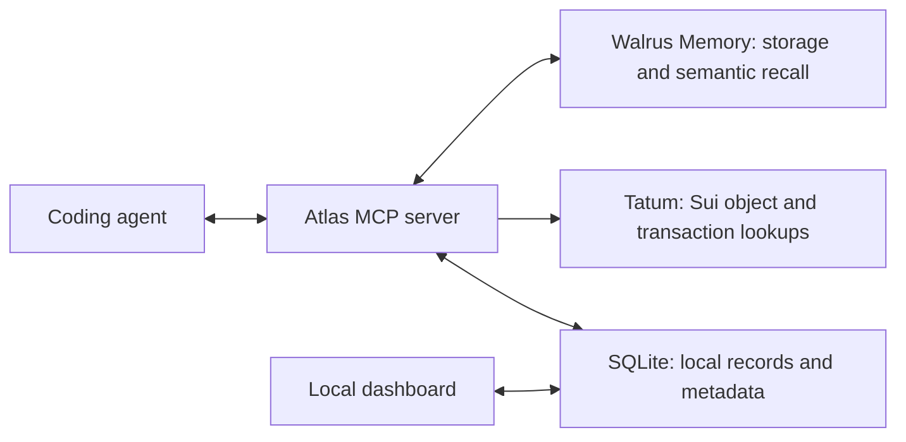

# Atlas

Persistent project memory for AI coding agents, built with Walrus Memory and Tatum.

Atlas helps your coding agent resume work with the decisions, bugs, tasks, and context from previous sessions. It connects through the [Model Context Protocol (MCP)](https://modelcontextprotocol.io/) and works with Claude Code, Codex, Cursor, and other MCP clients.

[Public website](https://atlas-a.vercel.app) · [Documentation](https://atlas-a.vercel.app/docs) · [Codex setup](https://atlas-a.vercel.app/docs#codex) · [Demo video](demo-video/renders/demo-video_2026-10-22_19-32-55.mp4) · [Installation guide](INSTALL.md) · [Architecture walkthrough](docs/blog/total-recall.md)

Built for the Tatum × Walrus **Total Recall** hackathon, Track 02: Smart Agents for Real Life.

## What you can do

Atlas records project knowledge through 15 MCP tools:

- **Resume a project**: retrieve the previous session summary, open tasks, decisions, and recorded project context
- **Preserve reasoning**: save decisions with their rationale and the alternatives considered
- **Find past knowledge**: search memories by meaning through Walrus Memory
- **Track work**: record bugs and TODOs with importance scores and tags
- **Verify Sui references**: look up object details and transaction status through Tatum
- **Prepare a handoff**: generate a session brief and local Markdown files for another agent or a teammate

Sessions record which agent did the work. Claude Code and Codex can use the same Atlas installation and local index.

## Install and start a session

Use Node.js **20 or newer**, npm, and an MCP client. For remote memory storage and semantic recall, create a delegate key and account in the [Walrus Memory dashboard](https://memory.walrus.xyz/dashboard). A [Tatum API key](https://tatum.io/) is recommended for blockchain verification.

### 1. Get the current release

The hackathon implementation is on `feat/cinematic-landing`. Clone that branch and create your configuration file:

```bash
git clone --branch feat/cinematic-landing https://github.com/greyw0rks/atlas.git
cd atlas
cp .env.example .env
```

### 2. Configure your credentials

Edit `.env` using the variables documented in [.env.example](.env.example):

| Variable | Purpose |
| --- | --- |
| `DATABASE_URL` | Local SQLite file; keep `file:./dev.db` for the default setup |
| `MEMWAL_PRIVATE_KEY` | Your Walrus Memory delegate private key |
| `MEMWAL_ACCOUNT_ID` | The onchain `MemWalAccount` object ID |
| `TATUM_API_KEY` | API key sent to Tatum as `x-api-key`, when configured |

**Use the account object ID for `MEMWAL_ACCOUNT_ID`.** Supplying the delegate public key causes HTTP 401 responses. Find the ID in the Memory dashboard or the `account_id` field of the `account::DelegateKeyAdded` event.

Keep your delegate private key in `.env`; this file is ignored by Git.

### 3. Run the installer

From the Atlas checkout, run:

```bash
./install.sh
```

The installer installs dependencies, creates the SQLite schema, builds the MCP server, and links the `atlas-mcp` command. It also registers Atlas with Claude Code and Codex and adds session instructions to their global configuration.

It backs up existing Claude settings before editing them and removes hooks that reference `HANDOFF.md`. Read [the installation guide](INSTALL.md) for configuration details, manual setup, and rollback instructions.

### 4. Ask your agent to use Atlas

Restart your MCP client, open the project you want to work on, and ask:

```text
Start an Atlas session for this repository.
Summarize the previous session, open tasks, and key decisions.
```

During work, ask it to record facts and reasoning:

```text
Save an ARCHITECTURE memory explaining how the API and dashboard share data.
Record this decision with its rationale and alternatives.
Search Atlas for previous decisions about authentication.
```

Before finishing, ask it to write a handoff and end the session:

```text
Create a handoff with what changed, what failed, and what should happen next.
End the Atlas session with that handoff and a summary.
```

The agent calls the tools; Atlas does not automatically record every conversation. To generate a separate project brief, ask it to run `atlas_generate_atlas_md`.

## How Walrus Memory and Tatum fit together

Atlas combines remote memory storage with a local index for your dashboard and session history:



### Walrus Memory stores and recalls memory text

Atlas sends memory and decision text to [Walrus Memory](https://memory.walrus.xyz/) on Sui Mainnet. The relayer handles embeddings, SEAL encryption, storage on Walrus, and semantic recall. Successful writes return a blob ID, which Atlas saves alongside the local record.

The dashboard links that ID to the Mainnet aggregator. The aggregator serves the encrypted blob; opening the link does not reveal readable memory text. Atlas retrieves text through authenticated Memory recall.

### Tatum checks blockchain references

Atlas extracts Sui object IDs and explicitly labelled transaction digests from memory text. It queries Tatum’s Sui remote procedure call (RPC) gateway for object type, owner, and version, or transaction execution status.

Atlas saves the structured result locally, including its network and timestamp. It appends a summary of the check to the text uploaded to Walrus. Failed lookups remain visible in the verification record.

These checks establish facts about the referenced objects and transactions at the time of lookup. They do not validate every claim in a memory. The integration uses Tatum’s RPC service directly.

## Open your local dashboard

The dashboard shows repositories, recent sessions, open tasks, decisions, and semantic search results. Memory and decision entries include Walrus blob links and Tatum verification details when available.

Start it from your configured Atlas checkout:

```bash
npm run dev
```

Open [the local workspace](http://localhost:3000/workspace). The dashboard and MCP server read the same SQLite file.

The Vercel deployment serves the public website and [local dashboard instructions](https://atlas-a.vercel.app/local-dashboard). Hosted dashboard routes redirect to that guide, and hosted memory API routes return HTTP 403. Your local database and signing credentials are excluded from the deployment.

## Storage behavior and current limits

The current implementation separates uploaded memory text from local project records:

- SQLite stores memory copies, repository context, session history, tags, importance scores, task status, and structured verification details. Full reconstruction of this metadata from Walrus is not implemented; keep a backup of your SQLite file.
- When credentials are missing or a Walrus write fails, Atlas keeps the record locally with `blobId: null` and reports `storedOnWalrus: false`. That record has no confirmed remote copy.
- Semantic search requires Walrus Memory. Local records remain available in the dashboard, but there is no local semantic search fallback.
- Machines using the same Memory account can recall uploaded text. Their local session histories and metadata do not automatically synchronize.
- Memory namespaces derive from repository names. Use distinct names for projects that should have separate recall namespaces.

## MCP tool reference

The server exposes these tools:

| Task | Tools |
| --- | --- |
| Start, review, and end sessions | `atlas_start_session`, `atlas_get_recent_sessions`, `atlas_end_session` |
| Read and update project context | `atlas_get_repository_context`, `atlas_update_context` |
| Save, search, and query work | `atlas_save_memory`, `atlas_search_memory`, `atlas_get_open_tasks` |
| Record decisions | `atlas_record_decision` |
| Generate handoffs and briefs | `atlas_create_handoff`, `atlas_generate_atlas_md` |
| Inspect repositories and history | `atlas_scan_repository`, `atlas_extract_git_memories`, `atlas_reconstruct_timeline` |
| Verify Sui references | `atlas_verify_onchain` |

Memories use nine [kinds](lib/memory/kinds.ts): `ARCHITECTURE`, `DECISION`, `BUG`, `TODO`, `WARNING`, `IMPORTANT_FILE`, `DEPENDENCY`, `SECURITY`, and `CONTEXT`. Each memory has an importance score from 1 to 5 and optional tags. Decisions record a title, rationale, and alternatives.

Ending a session writes `.atlas/` context, task, decision, and handoff files when the corresponding data exists. `atlas_generate_atlas_md` separately writes `ATLAS.md`.

## Develop Atlas

Atlas uses TypeScript, Node.js, Next.js, Prisma, SQLite, the MCP SDK, Walrus Memory, and Tatum Sui RPC.

After installation, run the checks from the repository root:

```bash
npm run lint
npm run build
npm run build --prefix mcp-server
```

The source is organized around these responsibilities:

| Path | Responsibility |
| --- | --- |
| [mcp-server/](mcp-server/) | MCP tools, environment loading, and Markdown exports |
| [lib/memory/memwal.ts](lib/memory/memwal.ts) | Walrus Memory writes and recall |
| [lib/memory/writer.ts](lib/memory/writer.ts) | Sessions, memory writes, and decisions |
| [lib/memory/retrieval.ts](lib/memory/retrieval.ts) | Context queries and recall result hydration |
| [lib/chain/tatum.ts](lib/chain/tatum.ts) | Sui reference extraction and verification |
| [app/](app/) | Public website, local dashboard, and API routes |
| [prisma/schema.prisma](prisma/schema.prisma) | Local database schema |

## License

Atlas is available under the [MIT license](LICENSE).
